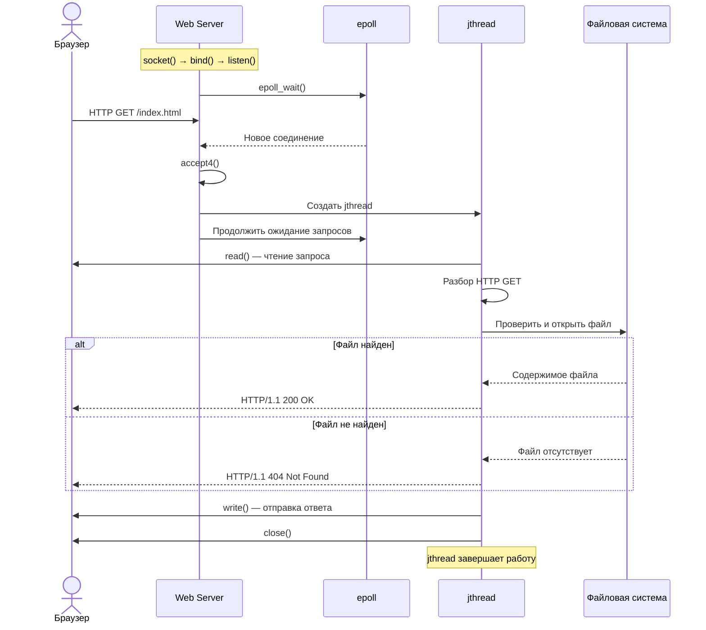

# C++20 epoll web server

## Архитектура
Сервер рассчитан на Linux.

`socket/bind/listen/accept4` создают TCP listener.
`epoll` мультиплексирует события listener и `eventfd` для пробуждения при завершении. 
Каждое принятое соединение обслуживается отдельным `std::jthread`;

`poll` с тайм-аутом используется при чтении HTTP-запроса, а отправка выполняется циклом `send`, учитывающим частичные записи. 
Файлы открываются в бинарном режиме и отправляются потоково, поэтому изображения не повреждаются. MIME определяется по расширению.

Обработка ограничена GET и HTTP/1.x. Реализованы ответы 200, 400, 403, 404, 405, 413 и 500. Для каждого ответа задаются `Content-Length` и `Connection: close`. `SIGINT` выставляет флаг завершения; поток-наблюдатель пробуждает `epoll` через `eventfd`. 

При остановке listener закрывается, а `jthread`-ы присоединяются.



## Сборка и запуск
Требуются Linux, компилятор с C++20 (например GCC 11+)

```bash
g++ -std=c++20 -O2 -Wall -Wextra -Wpedantic -pthread webserver.cpp -o webserver

./webserver 8080 ./www
```

Откройте `http://127.0.0.1:8080/`. Для завершения нажмите Ctrl+C.

## Проверки
```bash
curl -i http://127.0.0.1:8080/
curl -i http://127.0.0.1:8080/style.css
curl -i http://127.0.0.1:8080/sample.png -o /tmp/sample-response.bin
curl -i http://127.0.0.1:8080/no-such-file
curl -i -X POST http://127.0.0.1:8080/
```
